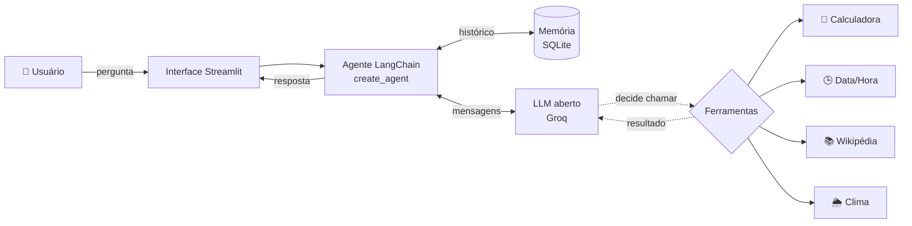

# 🤖 Assis: Meu Primeiro Agente de IA com LLM

Agente de Inteligência Artificial que recebe perguntas em linguagem natural e
responde usando um **Modelo de Linguagem de Grande Escala (LLM) de pesos
abertos**, com **interface web de chat**, **memória da conversa** e
**ferramentas** que o próprio agente decide quando usar.

| Requisito do trabalho | Como foi atendido |
|---|---|
| Perguntas em linguagem natural respondidas por um LLM | Modelos abertos (GPT-OSS, Qwen, etc.) via **LangChain** |
| Interface simples | Chat web em **Streamlit** (`app.py`) e versão de terminal (`cli.py`) |
| Manter o contexto da conversa | Memória com *checkpointer* do **LangGraph** + resumo automático de conversas longas |
| Modelos abertos, inclusive remotos via API | **Groq** (API gratuita na nuvem, com modelos de pesos abertos) |

## ✨ Funcionalidades

- 💬 Chat em português, com respostas formatadas em Markdown.
- ⚡ **Em tempo real, estilo ChatGPT**: a resposta aparece enquanto é escrita e o
  painel **Pensando…** mostra o raciocínio do modelo e cada pesquisa ao vivo.
  Depois ele recolhe em "Pensou por Xs". O nível de raciocínio (Rápido,
  Equilibrado ou Profundo) é ajustável em Configurações › Modelo.
- 🧠 **Memória**: lembra nomes, preferências e o que já foi dito na conversa.
- 🗂️ **Histórico de conversas** na barra lateral, como no ChatGPT: conversas
  agrupadas por data (Hoje, Ontem, ...), busca, renomear e apagar. Tudo fica salvo
  em `dados/assis.db` (SQLite), então continua lá depois de fechar o programa, e o
  agente continua lembrando do contexto ao reabrir uma conversa antiga.
- 🛠️ **Ferramentas** (é isso que faz dele um *agente*, não só um chatbot):
  - 🛡️ `pesquisar_fontes_confiaveis`: busca na web (DuckDuckGo) que **só aceita
    fontes confiáveis**: órgãos oficiais (gov.br, OMS, IBGE), universidades,
    revistas científicas e imprensa profissional/checagem. Blogs e sites
    desconhecidos são descartados.
  - 🔬 `pesquisar_artigos_cientificos`: artigos revisados por pares no
    [OpenAlex](https://openalex.org/), com autores, revista, citações e DOI.
  - 📚 `pesquisar_wikipedia`: visão geral de conceitos e biografias.
  - 🧮 `calculadora`: contas exatas (LLMs costumam errar aritmética).
  - 🕒 `data_hora_atual`: data e hora reais (o LLM não sabe que dia é hoje).
  - 🌦️ `previsao_do_tempo`: clima atual e previsão de 3 dias (Open-Meteo).
- 📑 Respostas com pesquisa terminam com uma seção **Fontes** com os links usados.
  As pesquisas seguem a ordem de confiabilidade: fontes confiáveis > artigos > Wikipédia.
- 🔍 A interface mostra **quais ferramentas o agente usou**, com entrada e resultado.
- ⚙️ Configurações em telas separadas (menu no topo): **Modelo** (modelo,
  temperatura, raciocínio, teste de conexão) e **Ferramentas e fontes**
  (liga/desliga cada uma). Trocar o modelo não apaga a conversa.

## 🏗️ Arquitetura



O agente segue o padrão **ReAct** (*Reason + Act*):

1. A pergunta do usuário é adicionada ao histórico da conversa (memória).
2. O LLM recebe o *prompt de sistema*, o histórico e a descrição das ferramentas.
3. O LLM decide: **responde direto** ou **pede para chamar uma ferramenta**.
4. Se pedir, a ferramenta é executada e o resultado volta para o LLM, que pode
   chamar outra ferramenta ou escrever a resposta final.
5. Tudo fica salvo na memória (identificada por um `thread_id`), então a
   próxima pergunta já chega com o contexto anterior.

Quando a conversa passa de ~6 mil tokens, o `SummarizationMiddleware` resume as
mensagens antigas e mantém as 20 mais recentes, para não estourar a janela de
contexto do modelo.

### Estrutura do projeto

```
agente-ia-llm/
├── app.py                 # Interface web (Streamlit): monta a navegação
├── cli.py                 # Interface de terminal
├── agente/
│   ├── nucleo.py          # LLM + memória + montagem do agente
│   ├── ferramentas.py     # Ferramentas (tools) do agente + catálogo
│   └── historico.py       # Conversas salvas em SQLite (+ memória do agente)
├── interface/
│   ├── estado.py          # Configurações e agente compartilhados entre telas
│   ├── estilo.py          # CSS da interface
│   ├── barra_lateral.py   # Lista de conversas antigas
│   └── paginas/           # chat.py, modelo.py, ferramentas.py, sobre.py
├── .streamlit/config.toml # Tema (cores e bordas)
├── tests/test_agente.py   # Testes automatizados (sem internet/chave)
├── requirements.txt
└── .env.example
```

## 🚀 Como executar

**Pré-requisito:** Python 3.10 ou mais recente.

```bash
# 1. Criar e ativar o ambiente virtual
python3 -m venv .venv
source .venv/bin/activate          # Windows: .venv\Scripts\activate

# 2. Instalar dependências
pip install -r requirements.txt

# 3. Configurar a chave (grátis em https://console.groq.com/keys)
cp .env.example .env               # depois edite o .env e cole sua chave

# 4. Rodar a interface web (abre em http://localhost:8501)
streamlit run app.py
```

Versão de terminal: `python cli.py`

### Publicar na internet (Streamlit Community Cloud)

> A Vercel não serve para este projeto: o Streamlit precisa de um servidor sempre
> ligado com conexão aberta (WebSocket), e a Vercel só roda funções curtas.

1. Entre em [share.streamlit.io](https://share.streamlit.io) com a conta do GitHub.
2. **Create app** → escolha este repositório, branch `main`, arquivo `app.py`.
3. Em **Advanced settings**, escolha Python 3.12 e cole nos **Secrets**:
   ```toml
   GROQ_API_KEY = "gsk_..."
   ASSIS_MODO_PUBLICO = "1"
   ```
4. **Deploy**. Cada novo `git push` atualiza o site sozinho.

Com `ASSIS_MODO_PUBLICO = "1"`, cada visitante vê só as próprias conversas (elas
ficam ligadas a um código no link, `?u=...`). No Streamlit Cloud o disco é
temporário: o histórico é apagado quando o app reinicia ou é atualizado.

### Testes

```bash
python -m pytest -q
```

Os testes usam um LLM falso, então rodam sem chave e sem internet. Eles
verificam a memória (o agente lembra da conversa), o "esquecimento" ao iniciar
nova conversa, o uso de ferramentas e a calculadora segura.

## 🎤 Roteiro de demonstração

| # | Digite | O que mostra |
|---|---|---|
| 1 | `Oi! Meu nome é Ana e eu estudo Ciência da Computação.` | Conversa natural |
| 2 | `Quanto é a raiz de 1764 vezes 3,5?` | Usa a 🧮 calculadora (resposta: 147) |
| 3 | `Quais os efeitos colaterais da vacina da dengue?` | Usa 🛡️ fontes confiáveis (gov.br, Fiocruz) e cita os links |
| 3b | `O que os estudos dizem sobre café e saúde do coração?` | Usa 🔬 artigos científicos, com DOI |
| 4 | `Vai chover em São Paulo amanhã?` | Usa a 🌦️ previsão do tempo |
| 5 | `Que dia da semana é hoje?` | Usa o 🕒 relógio |
| 6 | `Qual é o meu nome e o que eu estudo?` | **Memória**: lembra do passo 1 |
| 7 | Clique em **Nova conversa** e pergunte o nome de novo | Memória zerada |
| 7b | Na barra lateral, volte à primeira conversa e pergunte o nome | Conversas antigas são retomadas com contexto |
| 8 | Em **Configurações › Ferramentas e fontes**, desligue as ferramentas e pergunte `que dia é hoje?` | Sem ferramentas o LLM não sabe a data |

## 🧰 Tecnologias

- [LangChain](https://python.langchain.com/) e [LangGraph](https://langchain-ai.github.io/langgraph/): orquestração do agente e memória
- [Groq](https://groq.com/): API gratuita e rápida para modelos abertos
- [Streamlit](https://streamlit.io/): interface web
- [DuckDuckGo](https://pypi.org/project/ddgs/) (com filtro de domínios), [OpenAlex](https://openalex.org/), [Wikipédia API](https://www.mediawiki.org/wiki/API) e [Open-Meteo](https://open-meteo.com/): dados das ferramentas
